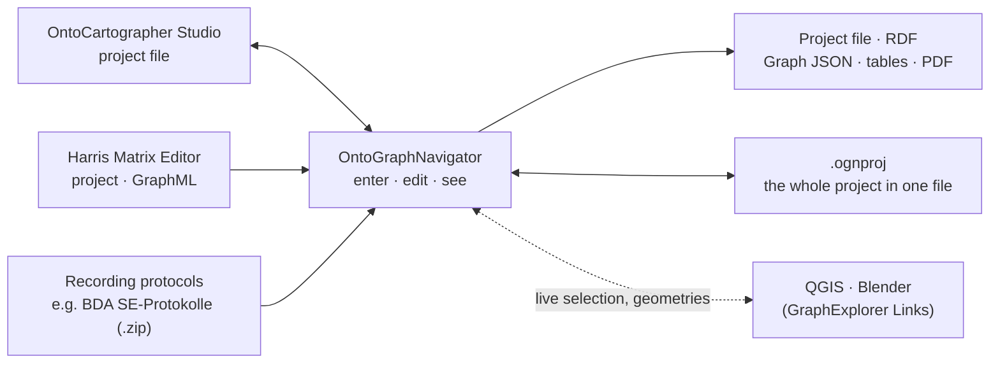
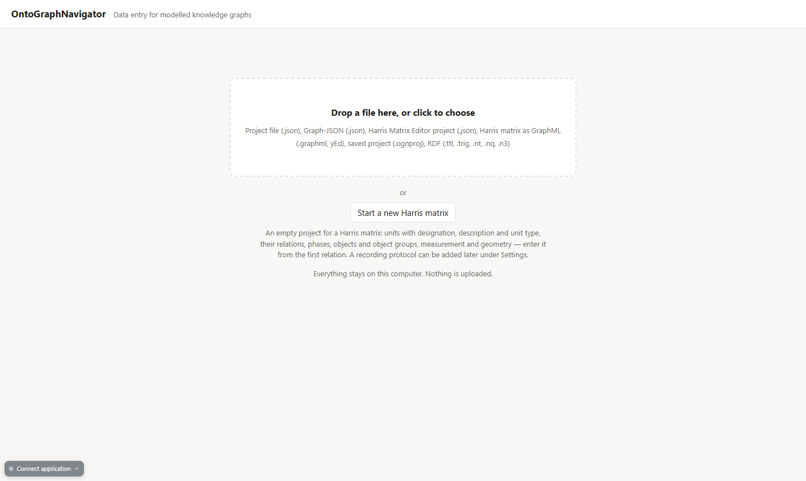
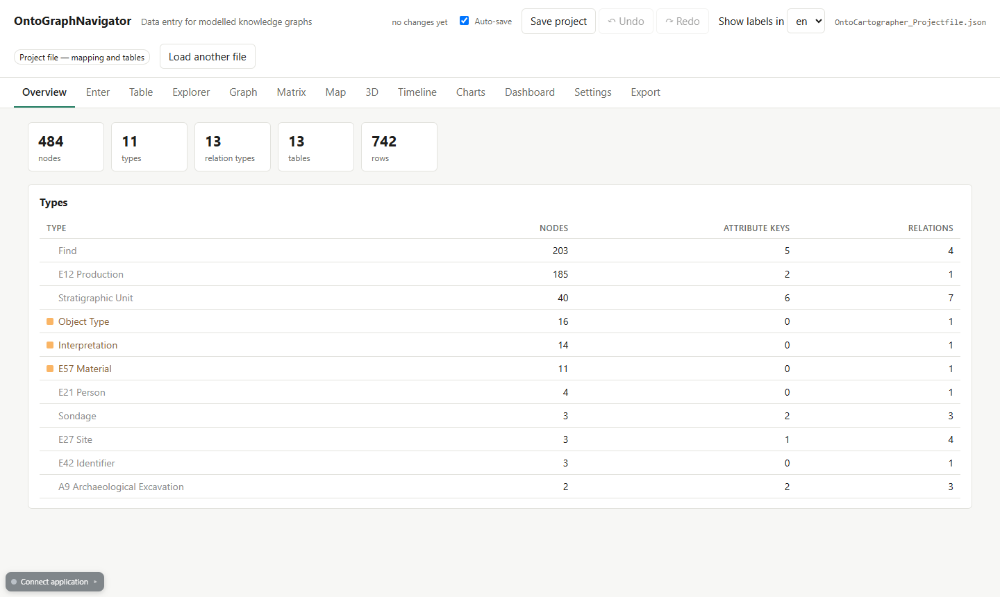
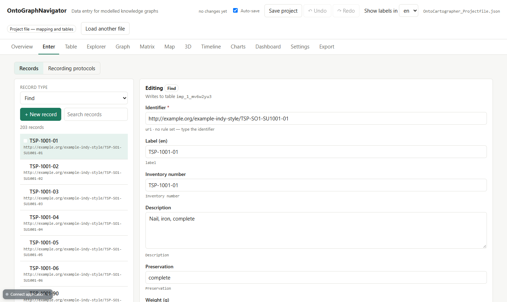
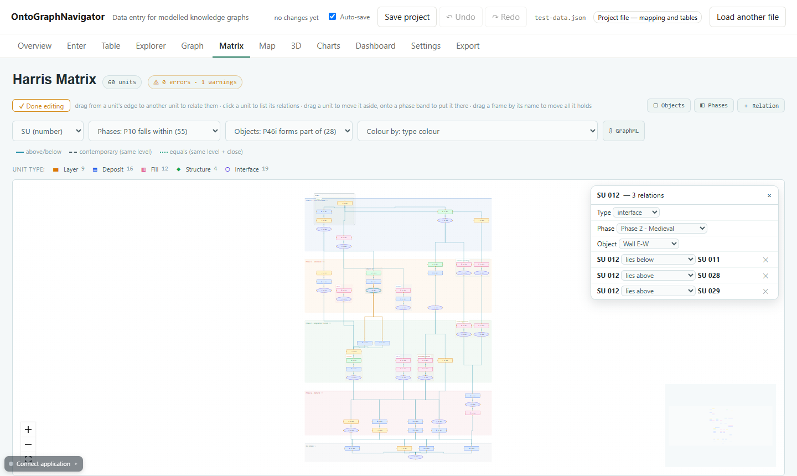
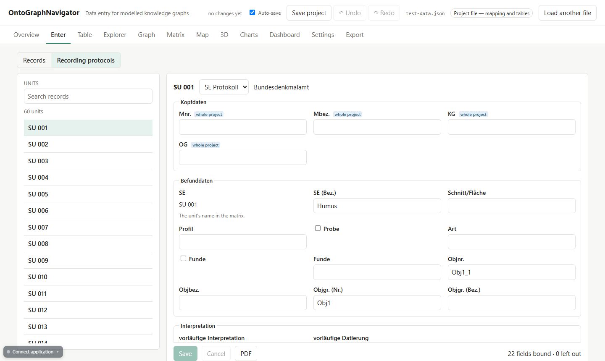
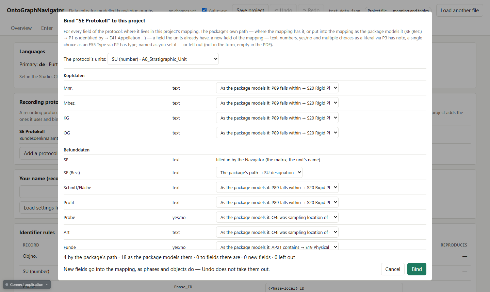
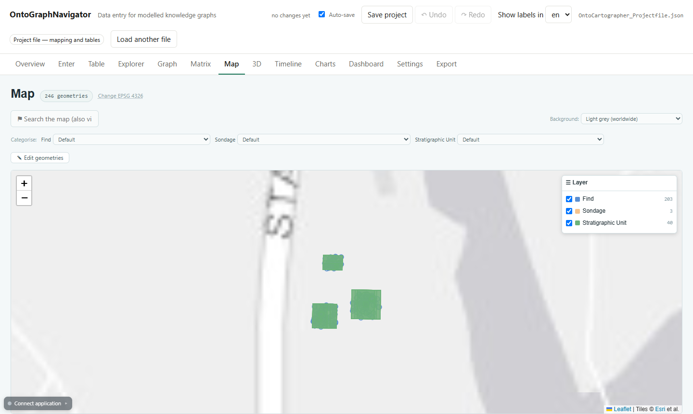
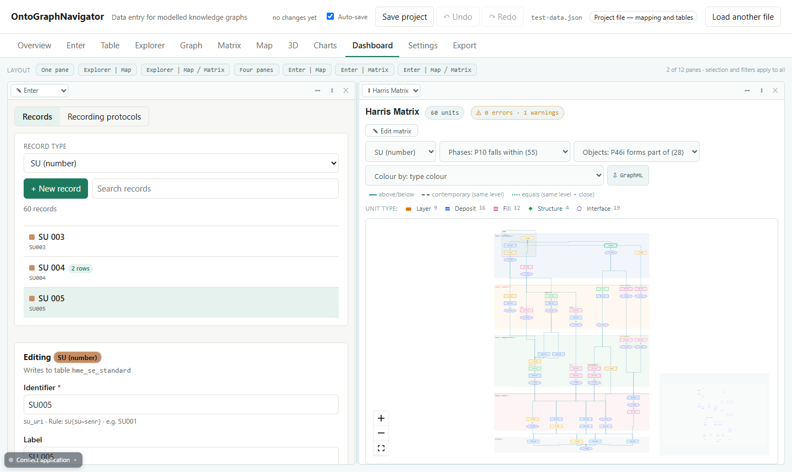

<p align="center">
  <strong>Enter, edit and see your knowledge graph — and draw its Harris matrix.</strong><br>
  The OntoGraphNavigator is a browser-based tool for working on the data of a knowledge graph modelled with OntoCartographer Studio: enter and correct records in forms made from your mapping, draw and edit a Harris matrix, record SE protocols, and see every change at once in the GraphExplorer's views — lists, network, matrix, map, timeline and charts, side by side if you like.<br>
  No code, no server, and your data never leaves your computer.
</p>

<p align="center">
  
  
  
  
  
</p>

---

## What is the OntoGraphNavigator?

[OntoCartographer Studio](https://github.com/oeai-dac/OntoCartographer-Studio) turns tables into a knowledge graph: you model once which column becomes which class and how they connect. The [GraphExplorer](https://github.com/oeai-dac/GraphExplorer) lets you look at the result from every angle. The OntoGraphNavigator is the tool in between, for the **daily work on the data**: add the finds of today's trench, correct a description, give a unit its phase, draw a new relation in the Harris matrix — and see it in the map and the timeline straight away.

It opens the Studio's **project file** — the mapping together with its tables — and gives you forms made from the mapping, the tables themselves, and the GraphExplorer's views over the data as you edit it. What you change goes back into the project file, so the Studio opens it again unchanged in every other respect, and every export the Studio and the GraphExplorer read can be written from here.

It also takes over the work of the **Harris Matrix Editor (HME)**: start a new matrix from scratch, or open an HME project, and edit units, relations, phases and objects right in the matrix — with recording protocols such as the BDA SE-Protokolle bound to the same data.

It runs in your browser, on your own computer. Nothing is uploaded anywhere.



### New to knowledge graphs?

- **Knowledge graph** — data stored as connections: *things* (a site, a layer, a find) and *how they relate* ("was found in", "consists of", "lies above").
- **Mapping** — the model you build in OntoCartographer Studio: which column of your tables becomes which kind of thing, and how they connect. The OntoGraphNavigator reads it and makes its forms from it.
- **Record** — one thing as you enter it: a find, a stratigraphic unit, a sample. In the graph it becomes a **node** with its **attributes** (plain values) and **connections** to other nodes.
- **Harris matrix** — the stratigraphic sequence of an excavation: which unit lies above which.

You do not need to know any of this in detail — if you can fill in a form, you can use the OntoGraphNavigator.

### Why the OntoGraphNavigator?

- **Forms without building forms** — they come from your mapping: one form per kind of record, with the right field for each value
- **The Harris matrix as a working tool** — draw relations, assign phases and objects by dragging, check the sequence; also from an empty project
- **Recording protocols on any mapping** — load a protocol package, decide once where its fields belong, then fill it in and print the official PDF
- **See every change at once** — the GraphExplorer's nine views over the data you are editing, side by side with the form
- **Nothing gets lost** — every change can be undone, is logged, and is saved in the browser while you work
- **Works with QGIS and Blender** — through the GraphExplorer's links, geometries and values come back from QGIS
- **Everything stays on your machine** — runs locally in your browser (no account, no cloud, no upload)

<details>
<summary><b>See all features</b></summary>

**Entering and editing**
- **Forms from the mapping** — one per kind of record; texts, numbers, dates, terms from a vocabulary, links to other records
- **Identifier rules** — new records get their identifier from a rule such as `SU{SU~senr}`; proposed from your data, editable in Settings
- **Vocabularies** — SKOS thesauri from a file or from the OeAI vocabularies; values offered from the data as you type
- **Table** — every table of the project, edited cell by cell
- **Several languages** — labels in every language of the project; the views shown in the one you choose

**The Harris matrix**
- **Relations** — *above*, *below*, *contemporary with*, *equals*: drawn from unit to unit, changed or removed with a click; new units on the way
- **Phases** — as bands; drag a unit (or a whole object) onto a band
- **Objects and object groups** — as frames around their units; created before any unit belongs to them
- **Unit types** — layer, deposit, fill, structure, interface, drawn as the HME draws them
- **Checks** — cycles, contradictions, phase order, units without phase — click a finding to see the units
- **Layout** — stable, phase by phase; units moved by hand stay where you put them
- **GraphML** — to and from yEd; the HME's own files open directly

**Recording protocols**
- **Packages** — a protocol, such as a BDA SE-Protokoll, is a `.zip` (its fields, its PDF form); none comes with the Navigator, a project adds the ones it uses
- **Binding** — a dialog decides for every field where it lives in your mapping, or adds it — once per project
- **Protocol form** — section by section; the filled-in PDF for one unit, or for all of them as one file or as a zip

**Seeing**
- **The GraphExplorer's views** — Overview, Explorer, Graph, Matrix, Map, 3D, Timeline, Charts — over the data being edited, with values and geometries edited in place
- **Dashboard** — several views side by side, the entry form as one of them: click a unit in the map or the matrix, and its record opens next to it

**Saving and exchanging**
- **Undo and redo** — every action, one step each
- **Auto-save** — a copy in your browser every 30 seconds, offered back after a crash
- **Project (.ognproj)** — the whole project in one file: data, settings, protocols, vocabularies, change history
- **Exports** — the project file for the Studio, Graph JSON for the GraphExplorer, RDF (TriG, Turtle), tables (TSV, CSV), the change log

**Connecting**
- **QGIS and Blender** — the GraphExplorer Links connect to the OntoGraphNavigator as to the GraphExplorer: selection in sync, attributes into QGIS, geometries, values and new records back from QGIS

</details>

---

## Installation

### Prerequisites

To run the OntoGraphNavigator you need Node.js (with npm):

- **Node.js 18+** (includes npm): download from <https://nodejs.org/en/download/>
- A current web browser (Firefox, Chrome, Edge, Safari, …). An internet connection is needed for the setup, and later only for map backgrounds and the online vocabularies — your data is never sent anywhere.

### Get the Project

Download the repository as a ZIP from GitHub (click **Code → Download ZIP** on the GitHub page) and unpack it, or clone it:

```bash
git clone https://github.com/oeai-dac/OntoGraphNavigator.git
cd OntoGraphNavigator
```

### Start

- **Windows:** double-click **`START-OntoGraphNavigator.bat`**
- **Mac/Linux:** open a terminal in the project folder and run `npm install` (only the first time), then `npm run dev -- --open`

On the first start, all required components are downloaded; this takes a few minutes. Afterwards your browser opens the OntoGraphNavigator at <http://localhost:3002>.

**To stop:** on Windows, close the window titled *OntoGraphNavigator*. On Mac/Linux, press `Ctrl+C` in the terminal.

### Updating

Replace the project folder with the new version (or `git pull`), delete the folder `node_modules`, and start again — the first start reinstalls everything.

### Uninstall

Delete the project folder — nothing is installed outside it (apart from Node.js itself). The auto-saved copy, added protocols and display settings are stored in your browser; clearing the browser's site data for `localhost:3002` removes them too.

---

## Quick User Guide

New to this? The [Detailed User Guide](#detailed-user-guide) walks you through everything.
Want to try it right away? Load the [example data](#example-data).

<b>Short overview for experienced users</b>

1. **Start** and choose on the start page: a **project file** of the Studio (or a saved `.ognproj`), **Start a new Harris matrix**, or an **HME project** / **GraphML** file.
2. **Enter** — choose a record type, open a record or create a new one, **Save**. *Recording protocols* switches to the protocol forms.
3. **Table** — the tables themselves, cell by cell.
4. **Matrix** — **✎ Edit matrix**: drag from one unit to another to relate them; click a unit for its relations, type, phase and object; drag units onto phase bands.
5. **Settings** — identifier rules, vocabularies, languages, your name, and **Add a protocol (.zip)**.
6. **Explorer, Map, Timeline, …** — the GraphExplorer's views; ✎ edits a value or a geometry in place.
7. **Dashboard** — e.g. *Enter │ Map*: click a unit on the map, its record opens beside it.
8. **Save project** (Ctrl+S) — one `.ognproj` with everything. **Export** — for the Studio, the GraphExplorer, RDF, tables, PDFs.

**Undo / Redo** are in the header (Ctrl+Z / Ctrl+Y). Matrix, Map and Timeline only appear when the data has what they need.

---

## Detailed User Guide

### Interface Overview

After loading a file, the OntoGraphNavigator shows a header and a row of tabs.

| Element | Details |
|---|---|
| Header | Number of changes not yet saved, **Auto-save**, **Save project**, **Undo** / **Redo**, the display language (for a project in several languages), the file name, **Load another file** |
| Tabs | **Overview**, **Enter**, **Table**, then the GraphExplorer's views as far as the data has what they need (**Explorer**, **Graph**, **Matrix**, **Map**, **3D**, **Timeline**, **Charts**, **Dashboard**), **Settings**, **Export** |
| Connect application | Bottom left: connects QGIS or Blender (see [Connect QGIS and Blender](#10-connect-qgis-and-blender)) |

### 0. Start

<p>
    
</p>

Drop a file onto the start page, or click it to choose one:

| File | What you get |
|---|---|
| **Project file** of OntoCartographer Studio (`.json`) | Your own mapping and data, editable: forms, tables, every view. The matrix wherever the mapping has stratigraphic relations. |
| **Saved project** (`.ognproj`) | Everything as you left it — data, settings, protocols, vocabularies, the change history (Undo still works). |
| **HME project** (`harris-matrix.json`) or **GraphML** | The Harris matrix: units, relations, phases, objects, unit types, geometries. The protocols come along if their package has been added (see [Recording protocols](#5-recording-protocols)). |
| **Graph JSON** or **RDF** (`.ttl`, `.trig`, `.nt`, `.nq`, `.n3`) | To look at, in all views — but not to edit: a graph no longer knows which table and column each value came from. |

Or click **Start a new Harris matrix**: an empty project with units (number, designation, description, unit type), relations, phases, objects and object groups, measurement and geometry — ready to draw the first relation.

### 1. Overview

<p>
    
</p>

The number of nodes, types, relation types, tables and rows, and every type with its count. Click a type to see its records in the Explorer. Messages about the loaded file — e.g. what came in from an HME project — appear here too.

### 2. Enter

<p>
    
</p>

1. Choose a **record type** (e.g. *Find*, *SU (number)*).
2. Open a record from the list (search above it), or **+ New record**.
3. Fill in the fields and **Save**.

The form comes from your mapping, so it has exactly the fields your model has:

- **Identifier** — filled in by the [identifier rule](#8-settings) when you save, or typed by you.
- **Terms** (e.g. a material, a unit type) — type and choose: from the bound vocabulary, from the values already in use, or a new one.
- **Long texts** (descriptions) get a large field.
- **Links to other records** (e.g. the unit a find was found in) — choose one of the existing records.

A record that is not connected to anything yet is saved in its table but does not appear in the views until it is linked — the form tells you so.

### 3. Table

Every table of the project, cell by cell — for corrections across many records. Every change goes into the same journal as the form: one Undo takes it back.

### 4. Harris Matrix

<p>
    
</p>

The matrix shows every unit with its relations, phase by phase (youngest on top), objects as frames, unit types as the HME draws them. The badge next to the title runs the **checks** — cycles, contradictions, units in the wrong phase — click a finding to see the units concerned.

Click **✎ Edit matrix** to work on it:

| To … | do this |
|---|---|
| relate two units | drag from the edge of one unit to the other, choose *above*, *below*, *contemporary with* or *equals* |
| enter a relation by name, also with new units | **＋ Relation** |
| see, change or remove the relations of a unit | click the unit — the panel lists them, each with ✕ |
| give a unit its type, phase or object | in the same panel; or drag the unit onto a phase band |
| move a whole object or group | drag its frame by its name — onto a band, and all its units get that phase |
| create, rename, order phases | **◧ Phases** |
| create objects and groups | **▢ Objects** — also before any unit belongs to them |
| lay the matrix out again | **↺ Arrange** (units you moved by hand stay put until then, also after saving) |

**⇩ GraphML** saves the matrix for yEd. The HME's projects and GraphML files open from the start page.

**Starting from scratch:** with **Start a new Harris matrix**, the Matrix tab shows an empty matrix; enter the first two units with **✎ Edit matrix → ＋ Relation**.

### 5. Recording Protocols

<p>
    
</p>

A recording protocol — such as the BDA SE-Protokoll — is a **package**: a `.zip` with its fields and its PDF form. No package comes with the OntoGraphNavigator: a project adds the ones it uses.

**Add a protocol** — *Settings → Recording protocols → Add a protocol (.zip)*. A dialog opens:

<p>
    
</p>

For every field of the protocol it proposes where it belongs in your mapping, and you can change it:

| Choice | Meaning |
|---|---|
| The package's path | the field is already in your mapping, where the protocol expects it |
| As the package models it | the field is added to your mapping the way the protocol models it (e.g. *SE (Bez.)* as an appellation of the unit) |
| A field the units have | one of your own fields |
| New: text / yes-no / type | a new field of your mapping |
| Leave out | not in the form, empty in the PDF |

**Bind** — the decisions are kept with the project; *Change binding …* in Settings opens the dialog again.

**Fill it in** — *Enter → Recording protocols*: choose a unit, fill in the form section by section, **Save**. **Protocol** in the matrix's unit panel opens it too. **PDF** prints the filled-in BDA form of this unit; *Export → SE protocols (PDF)* does all units at once, as one PDF or as a zip.

An **HME project** brings its protocols along when the matching package has been added before you open it.

### 6. The Views

**Explorer**, **Graph**, **Map**, **3D**, **Timeline** and **Charts** are the GraphExplorer's views — see the [GraphExplorer's user guide](https://github.com/oeai-dac/GraphExplorer#detailed-user-guide) for each of them. Here they show the data you are editing, and every change appears at once.

<p>
    
</p>

Two of them edit too:

- **Explorer** — ✎ next to an attribute changes its value.
- **Map** — **✎ Edit geometries**: click a geometry, drag its vertices, **Save**.

In a project with several languages, the language chosen in the header is used for labels and type names in every view.

### 7. Dashboard

<p>
    
</p>

Several views side by side. Besides the GraphExplorer's layouts, the bar offers **Enter │ Map**, **Enter │ Matrix** and **Enter │ Map ╱ Matrix**: the entry form as a pane of its own. Click a unit on the map or in the matrix and its record (or its protocol) opens next to it — unless you have unsaved changes in the form, which a click elsewhere never throws away.

Every pane can be split (⬌ ⬍), closed (✕) and switched to another view.

### 8. Settings

| Section | What it does |
|---|---|
| **Languages** | the languages of the project, from the Studio |
| **Recording protocols** | add, bind, rebind and remove protocol packages |
| **Your name** | recorded with every change in the log |
| **Identifier rules** | how new records get their identifier, e.g. `SU{SU~senr}` (SU + the number), `Obj_{Objno~local}` (Obj_ + the name); proposed from your data, editable |
| **Thesauri** | load a SKOS file or fetch an OeAI vocabulary, and bind it to a field |

### 9. Save and Export

- **Save project** (header, or Ctrl+S) — downloads one **`.ognproj`** file with everything: the project file, the settings, the protocols, the vocabularies and the change history. Open it again on the start page to carry on.
- **Auto-save** — every 30 seconds, the OntoGraphNavigator keeps a copy in your browser and offers it back on the next start. It is no substitute for saving: a cleared browser takes it along.
- **Export** —

| Export | For |
|---|---|
| Project (.ognproj) | carrying on here |
| Project file for the Studio | OntoCartographer Studio — your mapping and tables, with all changes |
| Graph JSON | the GraphExplorer |
| RDF (TriG, Turtle) | a triplestore, publication |
| Tables (TSV, CSV) | spreadsheets |
| SE protocols (PDF) | the filled-in protocol forms |
| Change log, settings file | documentation of every change |

### 10. Connect QGIS and Blender

The plugins **GraphExplorer Link for QGIS** and **GraphExplorer Link for Blender** connect to the OntoGraphNavigator exactly as to the GraphExplorer: click **Connect application** (bottom left) and connect from the plugin. The selection follows in both directions.

From QGIS you can also send data back: **Geometries → graph**, **Values → graph** and new records — each transfer is one step to undo. **Geometries from graph** takes the project's geometries into a QGIS layer.

---

## Example Data

The folder `0_exampleData/` contains a small, **entirely fictional** excavation — *Serpent's Meadow*, the same one the GraphExplorer comes with: two sites, three sondages, 40 stratigraphic units and 203 finds.

1. [Start the OntoGraphNavigator](#start).
2. Drop `0_exampleData/OntoCartographer_Projectfile.json` onto the start page.
3. **Enter → Find** — open a find, change its description, **Save**; see it in the **Explorer**.
4. **Map** — when asked for the coordinate system, enter `4326`.

| File | Content |
|---|---|
| `OntoCartographer_Projectfile.json` | The example as a project file of OntoCartographer Studio — English labels with German translations |
| `GraphExplorer_Example.json` | The same as Graph JSON (opens to look at, not to edit) |

For the **Harris matrix**, click **Start a new Harris matrix** on the start page and enter a few units — or open a project of the Harris Matrix Editor.

All sites, people, units, finds and dates are invented.

---

## Troubleshooting

### Installation and Start

**"node is not recognized" / Node.js was not found**
Node.js is not installed or not in your PATH. Install Node.js 18+ from <https://nodejs.org/en/download/> and start again.

**The browser does not open, or shows an error**
Look at the window opened by `START-OntoGraphNavigator.bat` (or your terminal): it prints the address, usually <http://localhost:3002>.

**Something behaves oddly after an update**
Delete the folder `node_modules` and start again (see [Updating](#updating)).

### Working with the Data

**I cannot edit — there is no Enter tab**
A Graph JSON or RDF file was loaded. Only a project file (or `.ognproj`, HME project, GraphML) can be edited.

**A new record does not appear in the views**
It is not connected to anything yet. Link it to another record (e.g. give a find its unit, or a unit a relation in the matrix).

**The Matrix tab is missing**
The mapping has no stratigraphic relations (Dot-One relations, as the Studio models them). Start a new Harris matrix, or add them to the mapping in the Studio.

**The protocol form says no protocol is bound**
Add a package under *Settings → Recording protocols* and bind it.

**I closed the browser without saving**
On the next start, the OntoGraphNavigator offers the auto-saved copy back. Save the project (`.ognproj`) as soon as you can.

---

## For Developers

The views are a copy of the GraphExplorer's `src/views/`, kept in step with `npm run sync-views`.

```bash
npm run check         # 26 test suites, about 500 checks, no browser needed
npm run bench         # timings on a project scaled up to 300k nodes
npm run sync-views    # bring the copy of the GraphExplorer's views up to date
```

Some checks compare against a real project of the OeAI in `_session/` — research data, which is not part of the repository — or use the BDA protocol packages in `protocols/`, which are not distributed either; without them, those checks skip themselves.

---

## Roadmap

| Version | Contents |
|---|---|
| 1.0 | Everything described above |
| 1.1 | More exchange formats: an SVG of the matrix, GeoJSON as a file, SE protocol records (JSON), RDF with RDF-star |
| later | CSV import, matching values against thesauri, XLSX export; working together on one project |

---

## License

GPL 3.0 or later — see [LICENSE](LICENSE).

---

## AI Assistance

The OntoGraphNavigator was developed with the AI coding assistant [Claude Code](https://claude.com/claude-code) by Anthropic. Claude was used to write and refactor code, to review it against the documentation, and to help with drafting the documentation. The concept, the requirements and the testing come from the author; every change was reviewed before it was adopted.

---

## Acknowledgments and Credits

Developed for digital archaeology and cultural heritage data management, as a companion to [OntoCartographer Studio](https://github.com/oeai-dac/OntoCartographer-Studio) and the [GraphExplorer](https://github.com/oeai-dac/GraphExplorer). The Harris matrix and the recording protocols take over the work of the Harris Matrix Editor; the BDA SE-Protokolle are the forms of the Austrian Federal Monuments Office (Bundesdenkmalamt).
